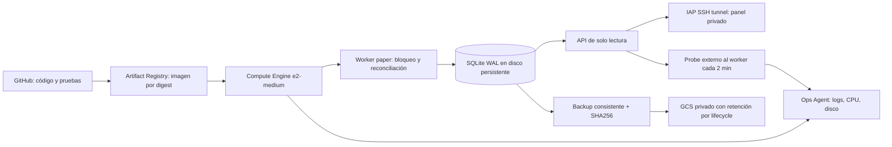

# Trading Lab: arquitectura GCP preparada, todavía sin desplegar

Fecha de precios y revisión: 2026-09-27, zona America/Mexico_City.

El código y CI continúan en GitHub. La ejecución diaria, observación y contabilidad pasan a un runtime único en Compute Engine. Esta implementación solo admite simulación; la conexión a GCP y la activación del worker quedan para una sesión posterior. Cuenta prevista: `brandonmuro.work@gmail.com`.

## Decisiones de infraestructura

- VM `e2-medium`, 4 GiB, CPU compartida, región `us-central1`, zona `us-central1-a`. Una futura alternativa `e2-small` de 2 GiB requiere medir RAM y rediseñar los límites de contenedores; esta configuración la rechaza. Sin Spot ni autoscaling del ejecutor.
- Disco `pd-balanced` dedicado de 30 GiB para `/var/lib/trading-lab`; boot independiente de 10 GiB. Terraform protege el disco y bucket contra destrucción, y la VM tiene deletion protection. No es alta disponibilidad: perder VM/zona exige recuperación y reconciliación.
- Docker ejecuta como UID/GID 10001, raíz de contenedor de solo lectura, límites de memoria, sin capabilities ni socket Docker dentro del contenedor. El bind del estado permite escritura para los sidecars SQLite WAL, incluso en la API; la API abre la base con `mode=ro` y `query_only` y carece de endpoints mutadores. Esto es lectura lógica de aplicación, no aislamiento del volumen a nivel de filesystem.
- Systemd supervisa procesos. `/var/lib/trading-lab/worker.enabled` es obligatorio tanto para systemd como para el runtime; solo `lab.ops activate --cutover-confirmed` lo crea tras validar el estado. El bootstrap no activa trading.
- VPC propia; único ingreso permitido, SSH desde IAP (`35.235.240.0/20`). API publicada exclusivamente en `127.0.0.1:8080` del host. OS Login, Secure Boot, vTPM e integridad habilitados. IPv4 estática permite salida a proveedores y una eventual lista permitida.
- Cuenta de servicio de VM: leer ese repositorio Artifact Registry, crear objetos nuevos en ese bucket y escribir telemetría. No puede borrar respaldos ni modificar infraestructura. Se conserva el alcance OAuth `cloud-platform`, limitado por estos roles IAM.
- Secret Manager solo tiene referencias opcionales a versiones numéricas existentes de ambas credenciales **Alpaca paper**. Terraform no consulta valores ni crea secretos. No se pasan credenciales Bitso/real. La API no recibe ninguna llave.
- WIF GitHub opcional, restringido a IDs inmutables de owner/repository, `main` y environment `gcp-delivery`; la identidad de entrega solo publica imágenes. No tiene permiso de iniciar el bot. No hay llaves permanentes de cuenta de servicio.
- Imagen Python y paquetes runtime fijados por digest/versiones; no se copian `.git`, `.env`, `state/` ni `data/`. El build rechaza una configuración con modo distinto de paper. La etiqueta OCI registra el SHA; la instalación exige digest e igualdad de SHA.

## Persistencia y recuperación

SQLite WAL vive sobre ext4 local en disco persistente; no sobre Cloud Storage FUSE ni carpeta Git. El backup usa `lab.ops backup`, que crea un archivo consistente y manifiesto SHA256; se verifica antes de subir ambos a GCS. Se ejecuta cada hora, conserva siete días locales y aplica lifecycle remoto de 35 días con versioning. No hay backup probado hasta ejecutar una restauración real en una carpeta vacía y contrastar contabilidad.

Objetivos operativos propuestos del piloto: recuperación del servicio en 60 minutos y pérdida máxima de historial de una hora ante pérdida completa del disco, sujetos a prueba de restauración. Para un broker externo, restaurar backup exige además reconciliar órdenes/ejecuciones posteriores; jamás reenviar porque no aparecen en una copia antigua. El estado del broker es independiente del backup.

El heartbeat se produce desde el host únicamente cuando `/readyz` confirma que el worker progresó recientemente. Monitoring detecta ausencia de heartbeat durante 15 minutos, CPU >85% durante 10 minutos y disco >80% durante cinco. Una métrica independiente registra backups completos: la ausencia de éxito durante dos horas dispara su propia alerta, aunque el worker siga sano. El script registra fallos con fase y código de salida; un proceso terminado abruptamente o un timer que no corre queda cubierto por la ausencia. Alertas operativas desactivadas hasta cutover, primer heartbeat, primer backup completo y canales de notificación verificados; antes de eso no existe cobertura operativa. Los logs Docker conservan la salida del programa dentro del campo `log`; las sondas y backups generan JSON estructurado directo. La retención/volumen de logs debe medirse.

## Presupuesto

Lista pública en USD, Iowa/us-central1, Linux bajo demanda, 730 horas/mes, sin compromisos, impuestos, conversión monetaria ni créditos:

| Componente | Estimación mensual |
|---|---:|
| e2-medium: 0.03350571 USD/h | 24.46 USD |
| Discos pd-balanced, 30 GiB estado + 10 GiB boot | 4.00 USD |
| IPv4 externa en uso: 0.005 USD/h | 3.65 USD |
| Base | **32.11 USD** |
| Objetivo incluyendo uso moderado de GCS, imágenes, logs y tráfico | **35–45 USD** |

Es una estimación, no una factura garantizada. Los 60 USD son presupuesto máximo de diseño; el recurso de Billing crea **alertas**, no corta automáticamente el gasto. El presupuesto usa costes antes de créditos para no ocultar el coste recurrente. Confirmar moneda de billing antes de habilitar el recurso USD. La documentación actual menciona spend caps en preview para algunos servicios; no se depende de esa función. Revisar el saldo, fecha final y servicios/SKUs cubiertos por los créditos; no se asume cobertura ni permanencia. No se ha consultado esa cuenta.

Un Cloud SQL Enterprise de ejemplo con 1 vCPU y 3.75 GiB ronda 49.31 USD/mes solo CPU/RAM; junto con la VM excedería el margen previsto. Los tipos de CPU compartida son más baratos pero no tienen SLA Cloud SQL. Por eso esta fase mantiene SQLite y un escritor único. Separar DB gestionada cuando haya varios procesos escritores, requisitos de HA o presupuesto suficiente.

## Alternativas

Cloud Run Jobs + Cloud Scheduler + DB externa es adecuado para trabajo finito diario/horario, después de separar completamente estado y ejecución. Scheduler entrega al menos una vez; la aplicación debe deduplicar. `parallelism=1` no evita dos ejecuciones diferentes a la vez. Jobs no aporta por sí solo un reconciliador continuo y el filesystem local no persiste. Puede usarse después para investigación aislada sin llaves ni estado operativo.

Render worker o Railway servicio con volumen, y un VPS convencional, también admiten este contenedor. No aprovechan los créditos disponibles. Render cron no dispone de disco persistente; Railway cron salta una corrida si la anterior sigue activa. AWS EventBridge/ECS es viable, pero añade componentes sin una ventaja inmediata para el piloto.

## Fuentes oficiales verificadas

- [Compute E2 y tarifas](https://cloud.google.com/products/compute/pricing/general-purpose)
- [Discos](https://cloud.google.com/compute/disks-image-pricing) y [red/IPv4](https://cloud.google.com/vpc/network-pricing)
- [Créditos: saldo, alcance y fechas](https://docs.cloud.google.com/billing/docs/how-to/resolve-issues)
- [Presupuestos de alertas](https://docs.cloud.google.com/billing/docs/how-to/budgets)
- [Cloud SQL](https://cloud.google.com/sql/pricing)
- [Cloud Run Jobs](https://docs.cloud.google.com/run/docs/create-jobs), [contrato filesystem](https://docs.cloud.google.com/run/docs/container-contract) y [Scheduler al menos una vez](https://docs.cloud.google.com/scheduler/docs/overview)
- [Ops Agent](https://docs.cloud.google.com/stackdriver/docs/solutions/agents/ops-agent/configuration)
- [GitHub schedule](https://docs.github.com/en/actions/reference/workflows-and-actions/events-that-trigger-workflows) y [concurrency](https://docs.github.com/en/actions/how-tos/write-workflows/choose-when-workflows-run/control-workflow-concurrency)
- [Render cron](https://render.com/docs/cronjobs), [Railway cron](https://docs.railway.com/cron-jobs), [AWS Scheduler/ECS](https://docs.aws.amazon.com/AmazonECS/latest/developerguide/tasks-scheduled-eventbridge-scheduler.html)
